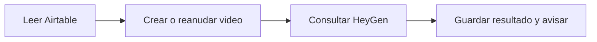
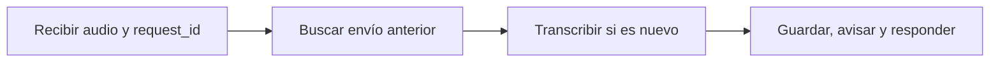

# Proyect One · Videos y audio con n8n

Este proyecto organiza dos tareas: pedir videos a HeyGen a partir de registros de Airtable y convertir archivos de audio en texto. Los resultados quedan en Airtable y los avisos llegan a Slack.

Son dos flujos separados. Transcribir un audio no genera un video automáticamente.

## Por dónde empezar

- [Configurá las cuentas e importá los flujos](docs/puesta-en-marcha.md).
- [Prepará las tablas de Airtable](docs/airtable.md).
- [Revisá las comprobaciones y sus límites](docs/validacion.md).

Los JSON de n8n se entregan sin activar y sin claves. Para trabajar con tus cuentas, hay que vincular las credenciales y completar el nodo `Configuracion`. La generación de videos empieza deshabilitada; la habilitás cuando decidas hacer una llamada real a HeyGen.

## Qué hace cada flujo

### Videos desde Airtable

[`01-videos-airtable-heygen.json`](workflows/01-videos-airtable-heygen.json) se inicia manualmente. Lee los registros pendientes, procesa uno por vez y guarda el identificador de HeyGen antes de consultar el resultado. Cuando el video está listo, actualiza el registro y avisa por Slack.

También consulta videos que ya están `En Proceso`. Si se corta la espera, podés volver a consultar el mismo ID en otra ejecución, sin pedir un video nuevo. Hay un límite de consultas para que la espera no quede abierta.



### Audio recibido por webhook

[`02-audio-a-airtable.json`](workflows/02-audio-a-airtable.json) recibe un archivo autenticado, lo transcribe con Groq y guarda el texto en Airtable. Devuelve una respuesta al cliente y envía el aviso por Slack.

Cada envío lleva un `request_id`. Si ese ID ya está guardado, el flujo recupera el registro antes de volver a transcribir. El título y la descripción se obtienen recortando la transcripción; no son resúmenes redactados por otro modelo.



La comprobación de IDs cubre reintentos secuenciales. No reemplaza un bloqueo entre ejecuciones simultáneas. La [guía de operación](docs/operacion.md) explica esa limitación y cómo revisar una ejecución que quedó a mitad de camino.

## Qué se conserva del diseño inicial

[`agente ia videos.json`](agente%20ia%20videos.json) sigue en el repositorio como referencia. Describe la idea original; los archivos de `workflows/` son los que se importan en n8n.

La implementación mantiene Airtable, HeyGen y Slack. Para transcribir se eligió Groq con `whisper-large-v3-turbo`. Las rutas de HeyGen se actualizaron a su API v3 y la resolución se configura aparte del formato MP4.

El [detalle del diseño](docs/diseno-original.md) conserva sus campos, el ejemplo de lectura y las decisiones que estaban abiertas. No se agregó descarga de videos, extracción de su audio ni conexión automática entre los dos flujos.

## Desarrollo y comprobaciones

Para regenerar los JSON y correr las pruebas locales, con Node.js 22 o posterior:

```sh
npm run verify
```

El [registro de validación](docs/validacion.md) distingue las pruebas locales, la compatibilidad con n8n y lo que falta comprobar con servicios reales. Una simulación no prueba los permisos, los créditos ni la configuración de tus cuentas.

**Tecnologías:** n8n, Airtable, HeyGen, Groq, Slack, HTTP/JSON, JavaScript y HTML. Las [referencias oficiales](docs/referencias.md) reúnen las APIs y las condiciones de los servicios que conviene consultar al configurar.

## Página de privacidad

[`index.html`](index.html) contiene un texto pendiente de revisión. Todavía no está confirmado que describa el funcionamiento de una aplicación real. Podés abrir el archivo o visitar la [página publicada](https://rashidzuain.github.io/privacidad-proyect-one/).

## Aportes

Si encontrás un problema, abrí un issue contando qué intentaste y qué pasó. Para proponer un cambio, enviá un pull request con una explicación breve y la forma en que lo comprobaste.

## Licencia

[MIT](LICENSE) · Rashid Zuain.
