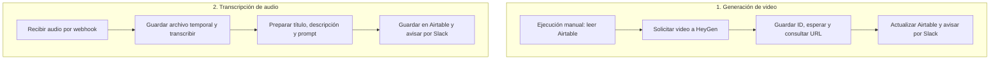

# Proyect One · Diseño de automatización audiovisual

Este repositorio reúne el diseño de dos flujos: uno para generar videos a partir de datos de Airtable y otro para transcribir archivos de audio. En ambos casos, la idea es guardar los resultados en Airtable y enviar avisos por Slack. Para el video se plantea usar HeyGen; el servicio de transcripción todavía está por definir.

También incluye una página HTML con un texto de privacidad pendiente de revisión. Todavía no está confirmado que describa el funcionamiento de una aplicación real.

**Estado de lo publicado:** el JSON describe los pasos y los datos previstos. La implementación ejecutable en n8n no está incluida.

[Explorar el diseño](agente%20ia%20videos.json) · [Ver la página de privacidad](https://rashidzuain.github.io/privacidad-proyect-one/)

## Qué incluye

| Archivo | Qué vas a encontrar |
| --- | --- |
| [`agente ia videos.json`](agente%20ia%20videos.json) | La especificación de los dos flujos: operaciones, campos, conexiones y avisos de error. |
| [`index.html`](index.html) | La página estática con el texto de privacidad y su estado de revisión. |
| [`LICENSE`](LICENSE) | La licencia MIT. |

## Los dos flujos

El siguiente esquema resume el recorrido previsto. Son dos flujos independientes:

### 1. De Airtable a un video con HeyGen

El primer flujo está pensado para iniciarse manualmente y seguir estos pasos:

1. Leer los registros de Airtable cuyo estado sea `Pendiente`.
2. Enviar el título y la descripción a HeyGen, con un avatar y una voz que hay que configurar.
3. Guardar el identificador del video y cambiar el estado del registro a `En Proceso`.
4. Esperar y consultar la URL del video.
5. Guardar esa URL en Airtable, marcar el registro como `Completado` y enviar un aviso por Slack.

El diseño también incluye avisos de error para las solicitudes a HeyGen.

### 2. De un audio a una transcripción en Airtable

El segundo flujo está pensado para recibir un archivo de audio a través de un webhook:

1. Guardar temporalmente el archivo recibido.
2. Enviarlo a una API de transcripción, que todavía hay que configurar.
3. Preparar un título y una descripción a partir de recortes del texto transcrito, junto con un prompt de video.
4. Guardar esos campos y la transcripción original en Airtable.
5. Enviar un aviso de resultado o error por Slack.

El archivo actual describe cada flujo por separado. No conecta automáticamente la transcripción con la generación de video, ni incluye la descarga de videos o la extracción de su audio.

### Un ejemplo para entender el recorrido

**Este ejemplo es hipotético; no representa una ejecución comprobada.** Un registro de Airtable podría tener `Titulo = "Tres ideas para organizar el estudio"`, una explicación en `Descripcion` y `Estado = "Pendiente"`. El primer flujo usaría esos datos para solicitar un video y, después de consultar su resultado, guardar `HeyGen_VideoID` y `URL_VideoGenerado`.

Por separado, el segundo flujo podría recibir un audio con esa explicación y guardar su texto en `TranscripcionOriginal`, junto con `Titulo`, `Descripcion` y `PromptVideo`. Ese registro no pasa automáticamente al flujo de video en el diseño publicado.

## Cómo explorar el proyecto

- Abrí [`index.html`](index.html) en un navegador o visitá la [página publicada](https://rashidzuain.github.io/privacidad-proyect-one/).
- Revisá [`agente ia videos.json`](agente%20ia%20videos.json) para ver los pasos, las expresiones y los campos previstos.

El JSON usa una estructura descriptiva propia, con claves como `workflow_name`, `flows`, `node_type` y `configuration`. **No es una exportación nativa de n8n lista para importar.** Para ejecutarlo, hay que construir los nodos y sus conexiones en n8n y configurar las integraciones.

## Qué falta para ejecutar este diseño

Estos son los puntos que quedan por resolver para pasar de la descripción a una implementación comprobable:

- Crear una exportación nativa de n8n para cada flujo.
- Configurar las credenciales, bases y tablas de Airtable; el avatar y la voz de HeyGen; los canales de Slack; y el proveedor de transcripción.
- Validar los endpoints, los formatos de solicitud y las respuestas de cada servicio.
- Revisar cómo se conservan los identificadores de Airtable entre pasos y cómo se manejan los archivos binarios.
- Incorporar la comprobación del estado del video, los reintentos y la respuesta del webhook.
- Documentar una ejecución de ejemplo con datos de prueba y resultados reproducibles.

Los valores `YOUR_..._HERE` son marcadores que hay que reemplazar al configurar las integraciones. El repositorio no incluye pruebas de ejecución de extremo a extremo.

## Tecnologías presentes en el diseño

**n8n · Airtable · HeyGen · Slack · HTTP/JSON · JavaScript · HTML**

El proveedor de transcripción todavía está por elegir. Los servicios mencionados en el JSON son ejemplos, no una integración ya implementada.

## Aportes

Si encontrás algo para corregir o tenés una idea para llevar el diseño a una implementación, podés abrir un issue. También podés enviar un pull request contando qué cambiaste y cómo lo comprobaste. Las sugerencias y correcciones son bienvenidas.

## Licencia

[MIT](LICENSE) · Rashid Zuain.
